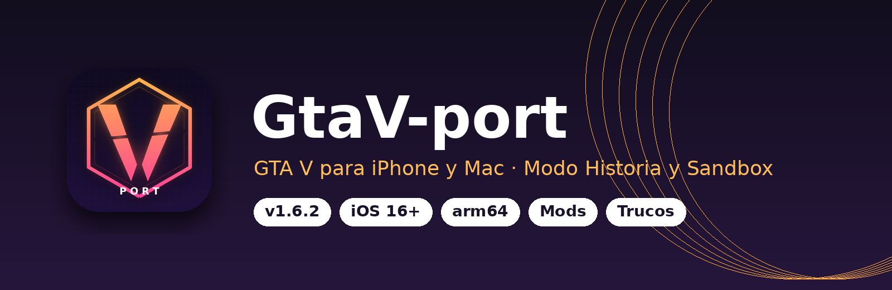
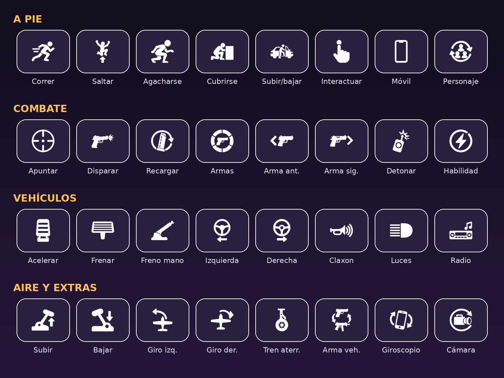

  

  
  
  
  
  

  <b>GTA V en tu iPhone y en tu Mac.</b> Modo Historia completo, modo Sandbox, mods, trucos y tu propia música en la radio.

---

## 📑 Índice
- [Qué es](#-qué-es)
- [Características](#-características)
- [Controles táctiles](#-controles-táctiles)
- [Requisitos](#-requisitos)
- [Instalación](#-instalación)
- [Añadir los archivos del juego](#-añadir-los-archivos-del-juego)
- [Mods](#-mods)
- [Rendimiento y ajustes](#-rendimiento-y-ajustes)
- [Solución de problemas](#-solución-de-problemas)

---

## 🎮 Qué es
**GtaV-port** es una app para iPhone y Mac con Apple Silicon que ejecuta **GTA V** (edición clásica) de forma nativa. La app es el motor: lee los archivos originales del juego y los ejecuta en el dispositivo con controles táctiles, giroscopio y soporte de mando.

> [!IMPORTANT]
> La IPA **no incluye el juego**. Necesitas tus propios archivos de GTA V (edición clásica, no *Enhanced*).

---

## ✨ Características

| | |
|---|---|
| 🏙️ **Modo Historia** | La campaña completa de Los Santos, con importación de partidas guardadas |
| 🧪 **Modo Sandbox** | Mapa libre para explorar y probar sin misiones |
| 🧩 **Mods** | Coches, skins y mods de script, que se activan o desactivan uno a uno desde Ajustes |
| 💥 **Trucos** | Menú de trucos integrado |
| 📻 **Self Radio** | Añade tus canciones (MP3, M4A, AAC, WAV, AIFF o FLAC) |
| 📱 **Controles táctiles** | Más de 60 botones contextuales: a pie, combate, coche, avión y helicóptero |
| 🌀 **Giroscopio** | Conduce o apunta inclinando el móvil |
| 🔍 **Verificador de archivos** | Comprueba que estén todos los archivos del juego y avisa si alguno está dañado o incompleto |
| 🎚️ **Preajustes gráficos** | De 30 a 60 FPS según el dispositivo, con un modo ligero para Macs de 8 GB |
| 🌍 **Multidioma** | Inglés, alemán, árabe, hebreo, chino, japonés, ucraniano y más |

---

## 🕹️ Controles táctiles

  

Los botones cambian según lo que estés haciendo: a pie, armado, conduciendo, volando o en el móvil del personaje.

---

## 📋 Requisitos

| | |
|---|---|
| **Sistema** | iOS 16 o superior, o macOS en un Mac con Apple Silicon |
| **Chip** | arm64 |
| **RAM** | Cuanta más, mejor (es lo que más influye en la estabilidad) |
| **Almacenamiento** | Espacio suficiente para todos los archivos de GTA V |

> [!TIP]
> Si instalas la app con una Apple ID gratuita, usa **AltStore 2.3 o posterior**, que da memoria extra a la app. Un triángulo rojo junto al contador de FPS indica que el móvil va justo de memoria.

---

## 📲 Instalación

1. Descarga **`GtaV-port-v1.6.2.ipa`** desde [**Releases**](../../releases/latest).
2. Ábrela con **SideStore** o **AltStore** y fírmala con tu Apple ID.
3. Abre **GtaV-port** desde la pantalla de inicio.

---

## 📂 Añadir los archivos del juego

1. Copia la carpeta de tu GTA V en la carpeta **GTA V Port**, desde la app **Archivos** del iPhone o desde el Finder del Mac.
2. Abre la app y pulsa **Añadir tus archivos del juego**.
3. La app los revisa uno a uno. Cuando salga *"Todos los archivos están completos"*, elige **Modo Historia** o **Sandbox**.
4. También puedes copiar el enlace de [**Releases**](../../releases/latest) y pegarlo dentro de la app: descargará el `.zip` o `.rar` y lo descomprimirá ella misma, dejando todos los archivos colocados en su carpeta sin que tengas que tocar nada.

> [!NOTE]
> Si un archivo sale con un icono de nube, todavía está en iCloud Drive. Descárgalo antes (Finder → clic derecho → *Descargar ahora*). Los `.7z` hay que descomprimirlos antes en un ordenador.

---

## 🧩 Mods

- Se instalan con un toque y se activan o desactivan uno a uno en **Ajustes › Mods**.
- Los cambios se aplican la próxima vez que abras el juego.
- ❌ **No compatibles:** mods en C# (ScriptHookVDotNet) y mods hechos para GTA V *Enhanced*.
- Si un mod de script deja demasiados coches, personas u objetos en el mundo, reinicia el juego y borra lo que hayas generado.

---

## ⚙️ Rendimiento y ajustes

El juego va a unos **30 o 60 FPS** según el dispositivo y el preajuste gráfico que elijas. Hay un preajuste ligero pensado para Macs de 8 GB.

Si el juego se cierra solo, cierra el resto de apps, baja el preajuste en **Ajustes › Gráficos** y desactiva los mods grandes de coches o texturas.

---

## 🛠️ Solución de problemas

| Problema | Solución |
|---|---|
| *"Un archivo tiene el tamaño incorrecto"* | La descarga o la descompresión se cortó. Libera espacio, borra la carpeta y vuelve a copiarla |
| *"Un archivo del juego no se puede leer"* | Comprueba que sea la edición clásica, no *Enhanced* |
| *"Un mod no es compatible"* | Desactívalo en Ajustes › Mods |
| La app se cierra al arrancar | Instálala con AltStore 2.3 o posterior y baja el preajuste gráfico |
| No se puede importar la partida | Carga la partida desde Pausa › Juego › Cargar partida |

---

Repositorio publico con copyrigth by ArkellMusic · v1.6.2

